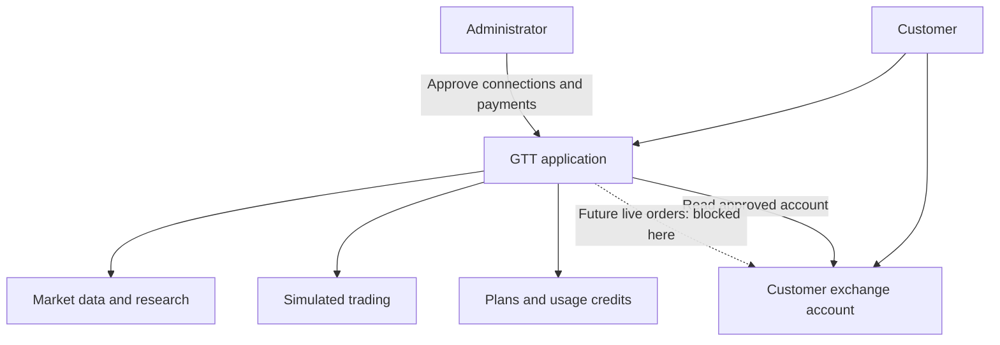
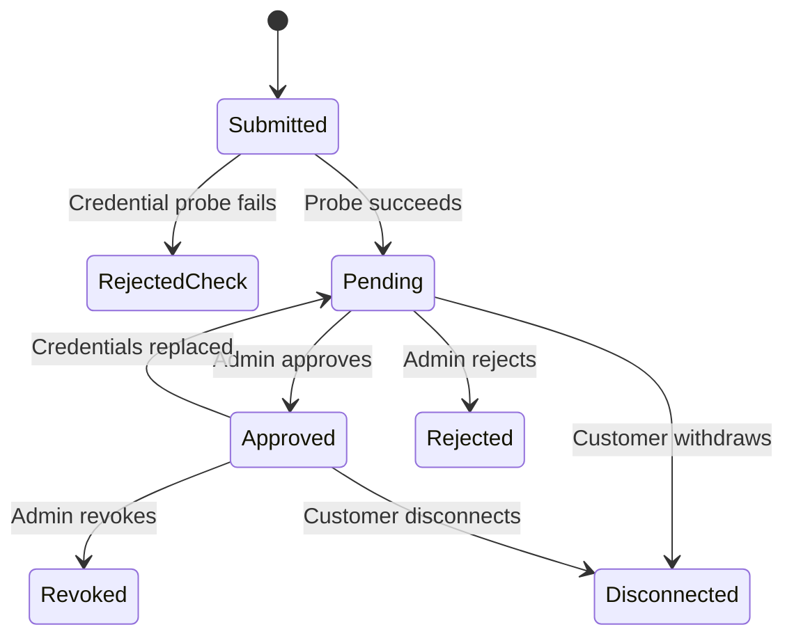
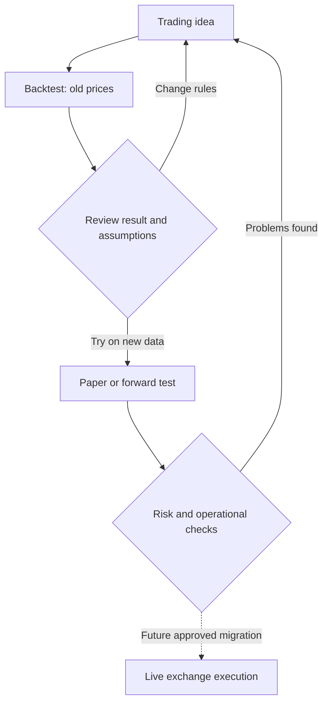
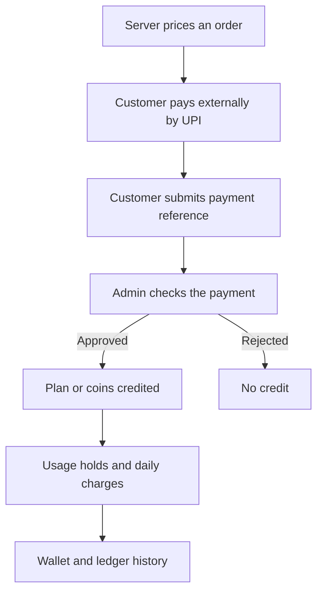

# 💼 Business & Crypto Guide

### Understand the product, the money and the trading concepts.

**GTT Platform** · Freelance onboarding · Source review: **29 October 2026**

[Documentation home](../README.md) · [Technical architecture](TECHNICAL_ARCHITECTURE.md)

---

> [!NOTE]
> **About the source:** these documents analyze the supplied developer review package, prepared on 25 September 2026. Source paths refer to that package; application source is not included in this documentation upload. Prices are code defaults, and runtime behavior has not been verified.

> [!NOTE]
> GTT is a trading research, practice and account-management platform. It brings market information, strategy results, backtesting, simulated trading, exchange portfolios and paid tools into one application. Its longer-term goal includes automated trading in a customer’s own exchange account. That live capability is not enabled in this supplied build.

## Contents

| Section | Explore |
| :---: | :--- |
| 01 | [Start here: what this business is providing](#1-start-here-what-this-business-is-providing) |
| 02 | [Who uses it and why](#2-who-uses-it-and-why) |
| 03 | [Where GTT sits in the ecosystem](#3-where-gtt-sits-in-the-ecosystem) |
| 04 | [Crypto explained from zero](#4-crypto-explained-from-zero) |
| 05 | [Three balances that must never be confused](#5-three-balances-that-must-never-be-confused) |
| 06 | [What each product area offers, and its actual status](#6-what-each-product-area-offers-and-its-actual-status) |
| 07 | [How a customer would move through the product](#7-how-a-customer-would-move-through-the-product) |
| 08 | [Understand strategy results without being misled](#8-understand-strategy-results-without-being-misled) |
| 09 | [How the business charges customers](#9-how-the-business-charges-customers) |
| 10 | [What the operator must do](#10-what-the-operator-must-do) |
| 11 | [Main business gaps before promising a launch](#11-main-business-gaps-before-promising-a-launch) |
| 12 | [Questions to ask the client before estimating work](#12-questions-to-ask-the-client-before-estimating-work) |
| 13 | [Source guide and scope of confidence](#13-source-guide-and-scope-of-confidence) |

---

## 1. Start here: what this business is providing

Think of GTT as a trading workbench. A customer can study a market, explore a trading idea, test it, practise with simulated money, and monitor connected exchange accounts without moving between many separate tools.

The branding in the billing configuration expands GTT to **“Gujju The Trader.”** In this repository, “GTT Coins” means credits for using the software. It does not mean a cryptocurrency issued by the platform, and the project name should not automatically be interpreted as a “Good Till Triggered” order product.

The intended value is convenience, repeatable trading processes and visibility into results. A strategy can still lose money. Automation executes rules; it does not make those rules profitable.

**Evidence:** `src/gtt/domain/billing.py::DEFAULT_CONFIG`, `frontend/src/App.tsx`, `frontend/src/features/strategies/meta.ts`.

### The three different things called “the platform”

| System or copy | What it means | What we can conclude |
| --- | --- | --- |
| Original application, referred to as `~/crypto` | Older application with trading engines and JSON state files | Repository notes describe it as operating alongside the rebuild. We did not inspect that system or verify that it is currently running. |
| Structured rebuild | New Python API, database, React interface and worker structure | Substantial code exists, but rollout and trading-engine migration remain separate questions. |
| Supplied developer review copy | The source folder available for this engagement | Proprietary functions were deliberately replaced with stubs. It is not a complete runnable demonstration of all advertised features. |

The developer handover note is dated **25 September 2026**. It lists 16 stripped modules and explains that related tests and parity evidence were removed. A stub keeps a function’s name and parameters but replaces its work with `NotImplementedError` or an empty constant.

This means “there is a Paper Trading screen” and “paper trading works in this copy” are different claims. Both documents consistently use **implemented code**, **partially wired**, **stubbed**, **legacy-dependent** and **planned** to avoid mixing them up.

**Evidence:** `README_FOR_DEVELOPER.txt`; `docs/MIGRATION_PLAN.md`; headers and bodies of `src/gtt/domain/paper.py` and `src/gtt/services/optauto.py`.

## 2. Who uses it and why

The following customer segments are inferred from the features, not validated by interviews or sales data.

| User | Need | GTT’s proposed answer |
| --- | --- | --- |
| New crypto trader | Understand markets and practise before using real money | Charts, simple educational tests, paper accounts and clear result screens |
| Active trader | See exchange balances, positions and research together | Portfolio aggregation, strategy pages, option chain and alerts |
| Strategy builder | Turn an idea into repeatable rules and test it | Strategy Studio, templates, backtests, parameter searches and forward tests |
| Customer interested in automation | Follow a systematic approach in their exchange account | Intended practice/live controls, allocations and account selection; live use is blocked here |
| Owner or administrator | Operate the service and control access | User management, broker approvals, payment verification, pricing and audit records |

There are two implemented account roles: customer and admin. An admin is not just another subscriber: they have privileged operations, and the billing service exempts administrators from usage charges.

**Evidence:** `src/gtt/db/models.py::Role`; `src/gtt/api/routers/admin.py`; `src/gtt/services/billing.py`.

## 3. Where GTT sits in the ecosystem

**Read this diagram as:** the customer uses GTT for tools and account visibility. The exchange is the place where real trading balances and positions live. Buying a GTT plan is a separate payment for software access.

The code includes portfolio adapters for Delta Exchange India, CoinDCX, Mudrex and Shark Exchange. That does **not** establish live order support for all four. Public market data is principally integrated through Delta, with CoinGecko enrichment and separate news/calendar sources.

No blockchain node, smart-contract deployment, token issuance or self-custody wallet workflow was found in the reviewed source. The technical work is mainly a web application plus exchange API integrations. Customer API keys are still sensitive: trading permission can affect real money even without withdrawal permission.

**Evidence:** `src/gtt/services/brokers/__init__.py`; `src/gtt/services/market/`; `src/gtt/services/execution/`; dependency manifests.

## 4. Crypto explained from zero

### Cryptocurrency, blockchain and exchange

A cryptocurrency is a digital asset recorded on a blockchain: a shared transaction record maintained by a network of computers. Bitcoin is commonly abbreviated **BTC**; Ethereum’s native asset is **ETH**. You can trade these assets, but many products shown in GTT are contracts whose value follows an asset, rather than ownership of that asset.

An **exchange** is a trading venue. An exchange account keeps balances and trading records for its customer. A **self-custody wallet** instead involves managing the keys used to control blockchain assets. GTT’s “Wallet” screen is a third meaning entirely: it tracks software credits.

Reference: [Coinbase: What is cryptocurrency?](https://www.coinbase.com/learn/crypto-basics/what-is-cryptocurrency).

### Spot, futures, perpetuals and options

| Term | Simple meaning | Why it matters here |
| --- | --- | --- |
| Spot trading | Buy or sell the asset itself | Some connected exchanges expose spot balances. |
| Derivative | A contract whose value depends on something else | GTT’s research heavily involves crypto derivatives. |
| Futures | A contract with a defined expiry or settlement arrangement | Requires understanding contract quantity and margin. |
| Perpetual futures, or “perps” | Futures-like contracts without a fixed expiry | Used by the strategy builder and execution scaffolding. |
| Long | Exposure that benefits when the relevant price rises | A strategy can take an upward view. |
| Short | Exposure that benefits when the relevant price falls | A strategy can take a downward view. |
| Funding | Periodic payments between long and short perpetual positions | Can change the profit of a trade held over time; the interval and rate are contract-specific. |

A trading symbol such as `BTCUSD` tells you what is being priced, but does not by itself establish the settlement currency or quantity per contract. Read the exchange product metadata. Buying one contract is not necessarily buying one bitcoin.

References: [Delta perpetual guide](https://guides.delta.exchange/delta-exchange-india-user-guide/derivatives-guide/docs) and [Delta API product definitions](https://docs.delta.exchange/).

### Margin and leverage: a small worked example

**Margin** is collateral supporting a derivatives position. **Leverage** is the size of the exposure compared with the capital supporting it.

Illustration: ₹10,000 supports ₹50,000 of exposure, which is 5× leverage. A 2% favorable move produces approximately ₹1,000 gross profit; a 2% adverse move produces approximately ₹1,000 gross loss. That is about 10% of the ₹10,000 margin in either direction, before fees, funding and other effects.

**Liquidation** is the exchange reducing or closing a position when collateral no longer satisfies its requirements. It is different from a strategy’s chosen stop-loss. You should not derive a precise liquidation price from leverage alone.

**Initial margin** is the entry requirement; **maintenance margin** is the minimum required to keep the position. GTT has margin-related interfaces, but its proprietary margin policy is removed from this copy.

Reference: [Delta margin explainer](https://guides.delta.exchange/delta-exchange-india-user-guide/trading-guide/margin-explainer). The numbers above are an original simplified illustration, not a product quote.

### Options in plain language

A **call** gives the buyer upside exposure above a strike; a **put** gives downside exposure below a strike. The **strike** is the contract’s reference price, **expiry** is its ending date, and **premium** is the option price. An option seller receives premium and takes on the corresponding obligation.

Illustration, per unit of underlying at expiry: a call with strike $100 and premium $5 has a gross payoff of $10 when the settlement price is $110, leaving $5 profit before costs. At a settlement price of $95 it expires without payoff and loses the $5 premium. Real contract multipliers must be applied.

A **leg** is one component of a combined position. An **option chain** lists contracts by strike and expiry. A **payoff chart** estimates the combined result across settlement prices; it is not a promise of the price available before expiry. Option selling can have substantial losses.

Reference: [Delta options guide](https://guides.delta.exchange/delta-exchange-india-user-guide/derivatives-guide/options-guide).

### Prices and trade records

| Term | Meaning |
| --- | --- |
| Bid / ask | Prices available to sell / buy; their difference is the spread |
| Mark price | A reference price used to value open positions and assess liquidation |
| Fill | The price and quantity actually executed |
| Order | An instruction to trade; it may not fill, or may fill only partly |
| Position | The exposure remaining after trades |
| Unrealized P&L | Estimated profit or loss on an open position |
| Realized P&L | Profit or loss recorded when a position is closed |
| Fees / slippage | Trading charges / difference between the assumed and actual execution price |
| Stop-loss / take-profit | Instructions or rules intended to exit at loss/profit thresholds |

A mark price is not a guaranteed fill price. A stop-loss also does not guarantee the exact loss shown in a simulation. These distinctions matter when comparing paper results with exchange results.

Reference for mark versus executed prices: [Delta fair-price marking](https://guides.delta.exchange/delta-exchange-india-user-guide/trading-guide/fair-price-marking). Record terminology is reflected in `services/execution/base.py` and `db/models_paper.py`.

## 5. Three balances that must never be confused

| Balance | Where it lives | What it can do |
| --- | --- | --- |
| Real exchange funds | Customer’s external exchange account | Support real positions and exchange charges |
| Paper capital | GTT’s simulation records | Measure hypothetical trading performance |
| GTT Coins | GTT billing ledger | Pay for metered software features |

Paying ₹499 for a Starter subscription does not deposit ₹499 into an exchange account. Receiving 600 GTT Coins does not mean receiving 600 BTC, tokens or rupees of trading capital. A simulated ₹2,000 profit is not a withdrawable profit.

The reviewed billing implementation does not provide a GTT Coin blockchain transfer or exchange-withdrawal function. Coin grants, spending and expiry are internal database events.

**Evidence:** `domain/billing.py`; `db/models_billing.py`; `db/models_paper.py`; `api/routers/brokers.py`.

## 6. What each product area offers, and its actual status

| Area | User-facing purpose | Status in this review copy |
| --- | --- | --- |
| Account and login | Sign in, edit profile, manage devices and password | Implemented code and tests present |
| Sign-up and reset | Verify a mobile-number code | API and OTP logic present; no working SMS delivery integration is wired |
| Markets and charts | Prices, candles, indicators and market context | Implemented read-only code; requires reachable external data |
| Coin analysis | Indicators, patterns, verdict and basic tests | Mixed: indicator/simple-test code remains; proprietary verdict logic is stubbed |
| Strategy catalogue | Understand strategies and review their records | Frontend descriptions remain; result assembly is stubbed and original records are external |
| Options chain and payoff builder | Inspect contracts and model combinations | Public-data/UI calculation code exists; do not confuse this with automated options trading |
| Strategy Studio | Define rules, test ideas and tune parameters | UI and orchestration exist; central engines/templates/optimizer are removed |
| “Describe it” AI builder | Turn plain text into strategy rules | UI calls `/builder/describe`; no matching backend route was found |
| Paper trading | Follow strategies with simulated capital | Models, routes and worker scaffolding remain; core engine/service is stubbed |
| Forward testing | Observe a custom idea on new candles | Paper-only orchestration exists but depends on the removed strategy engine |
| My option strategies | Track multi-leg strategies and automated paper runs | UI/models/routes remain; domain and service logic are stubbed |
| Portfolio | Read approved exchange balances and positions | Four read-only broker adapters and approval logic exist |
| Auto-trade | Choose accounts, allocations and mode | Controls and policy scaffolding exist; missing rules and blocked live activation |
| Pricing and wallet | Buy plans/credits and inspect usage | Significant billing implementation exists; manual payment verification |
| News, calendar and Telegram | Context and notifications | Integration code present; feeds, bot configuration and running poller are required |

“Implemented” means source implementation was inspected; it does not mean a live deployment or end-to-end customer journey was verified.

**Evidence:** `frontend/src/App.tsx`; `api/routers/`; `README_FOR_DEVELOPER.txt`; `frontend/src/features/builder/studioStore.ts::aiBuild`.

## 7. How a customer would move through the product

### Joining and connecting an exchange

1. Create an account or have an admin create one. Self-service delivery requires the missing SMS integration.
2. Sign in using the mobile number and password.
3. Browse available market and research screens.
4. Add exchange credentials and confirm account ownership.
5. GTT makes a read-only credential check and encrypts the credentials.
6. The request waits for an administrator’s approval.
7. Approved accounts can appear in Portfolio. Rejection or revocation wipes stored key material; withdrawal deletes the connection.
8. Trading permissions remain a separate concern. Portfolio approval does not activate live trading.

Replacement credentials return the connection to review. The customer sees only a key hint, not decrypted secrets.

**Evidence:** `api/routers/brokers.py::connect`, `admin_decide`, `withdraw`, `portfolio`.

### Learning, testing and deployment

This is the intended learning journey. Removed engines and blocked live switches prevent completing the full journey in this copy.

## 8. Understand strategy results without being misled

A **strategy** is a set of entry, exit and sizing rules. A **signal** is an observation suggesting an action; it is not proof that an order was placed.

A **backtest** applies rules to historical prices. A **paper test** simulates orders without risking exchange funds. A **forward test** observes a strategy after its start date using newly arriving data. A **shadow run** is an execution rehearsal that records intended actions without sending live orders. A **live record** should be supported by actual exchange fills.

| Result term | Question it answers | Limitation |
| --- | --- | --- |
| Net P&L | How much was gained or lost after included costs? | Check which costs were actually modeled |
| Win rate | How often did trades make money? | Many small wins can be outweighed by a few large losses |
| Drawdown | How far did the account fall from an earlier peak? | A past maximum is not a future loss limit |
| Equity curve | How did account value change over time? | Different capital and leverage assumptions change comparisons |
| R multiple | Return relative to the intended risk of a trade | The risk unit must be defined consistently |
| CAGR | Annualized compounded growth over a period | Short or simulated histories can make this misleading |
| Sample size | How many trades and market conditions were observed? | A small record cannot establish robustness |

The surviving educational `simple_backtest.py` is explicitly long-only, uses full capital per trade, and excludes leverage, fees and slippage. It should be described as an educational approximation. That is distinct from the stripped Studio engines, whose complete cost and execution rules cannot be verified here.

The frontend lists 11 strategy identifiers: breakout, momentum, XRP trend, iron fly, covered call, four BTC/ETH options variants, EMA51 and market structure. Two are described as gold strategies. Thus the catalogue is broader than only BTC and ETH.

Those descriptions explain positioning, not verified profitability or exact proprietary rules. For example, “iron fly” describes a premium-collection approach with purchased protection; the actual strikes, sizing, entry times and exit logic are unavailable. Do not reconstruct those rules from the marketing text.

**Evidence:** `frontend/src/features/strategies/meta.ts`; `domain/simple_backtest.py`; `domain/strategy_results.py`.

## 9. How the business charges customers

The code suggests a subscription-plus-usage model: some features are listed as free, plans grant periodic credits and entitlements, and additional credit packs can be purchased. This is an inference about the intended business model, not evidence of current revenue.

### Default plan configuration

These are repository defaults, not verified current commercial prices. Admin overrides can change them. Live entitlements in the configuration do not make live execution available.

| Plan | Monthly price | Coins per 30-day drop | Coin validity | Configured live entitlements |
| --- | --- | --- | --- | --- |
| Starter | ₹499 | 600 | 30 days | None |
| Pro | ₹1,299 | 2,000 | 60 days | 2 own algos; 1 GTT strategy |
| Elite | ₹2,999 | 6,000 | 90 days | 5 own algos; all GTT strategies |

Quarterly and yearly purchase options are also defined. Yearly purchases include an additional coin allocation in the billing rules. Prices include a configurable tax component; the default is 18%. This is a description of software configuration, not a tax determination.

### Example usage charges

| Action | Default GTT Coins |
| --- | --- |
| Options backtest up to one year | 5 |
| Options backtest for two years | 10 |
| Perpetuals backtest | 5 |
| Strategy enhancer | 25 |
| DCA basket test | 10 |
| Paper algo / GTT paper strategy | 2 per eligible running day |
| Live algo | 10 per eligible running day; unavailable here |
| AI “Describe it” | 3 configured; endpoint missing here |

The default welcome allocation is 50 coins valid for 30 days. Top-up packs and ordinary admin grants last 365 days. Spending consumes the soonest-expiring available coins first. Plan coins are dropped every 30 days; this is not the same as a calendar-month billing implementation.

A paid test first **holds** credits. Success settles the charge; failure or cancellation releases the hold. Repeating the same paid test within the configured 24-hour window is intended to be free. Running paper/algo usage is metered per day, with a warning and a 24-hour grace period when funds are insufficient. The pause behavior depends on the connected engine service, which is removed in this copy.

**Evidence:** `domain/billing.py::DEFAULT_CONFIG`, `replay`, `meter_step`; `services/billing.py`.

### Payment flow

The payment reference is a **UTR**, a transaction reference used during verification. A typed UTR is not proof that money arrived. The current process depends on a human checking the payment. No automated payment-gateway settlement was found.

**Evidence:** `services/billing.py`; `api/routers/billing.py`; `frontend/src/features/billing/Checkout.tsx`.

## 10. What the operator must do

The service needs ongoing operational work: approve exchange connections, verify payments, handle failed integrations, maintain prices and plans, monitor workers, support account recovery, and reconcile customer complaints against the ledger and audit records.

The separation of responsibilities should be explicit:

| Responsibility | Current expected owner |
| --- | --- |
| Customer funds and exchange account setup | Customer and exchange |
| GTT software access, credits and support | GTT operator |
| Approval of exchange credentials and manual payments | GTT administrator |
| Strategy behavior and acceptable trading risk | Client/strategy owner; exact rules are absent |
| Software changes and integration quality | Development team |
| Commercial, privacy and regulatory decisions | Business owner with appropriate specialists |

The repo does not establish paying-customer count, retention, operating revenue, infrastructure spend, conversion rate or independently verified strategy returns. Those require business records and owner discussion.

## 11. Main business gaps before promising a launch

| Gap | Why a new customer would care | Decision needed |
| --- | --- | --- |
| Removed proprietary engines | Core research/practice journeys may fail or show no data | Will the engagement receive private modules, a hosted API, or interface-only scope? |
| Live trading unavailable | Paid plan descriptions can imply more than this build delivers | Define and gate the actual launch offer |
| SMS delivery missing | New customers cannot receive verification codes through the wired sender | Select and integrate delivery |
| Manual payment checks | Access can depend on administrator availability | Define support time and gateway roadmap |
| Legacy data dependency | Historical strategy results are not contained in this package | Provide sanitized fixtures and identify the authoritative data source |
| Unclear evidence labels | Users may confuse backtests, models and real account performance | Label every result and its assumptions |
| Production configuration unverified | Code presence does not prove a running, monitored service | Agree staging and launch acceptance criteria |

No legal status, exchange registration or tax treatment is certified by this review. The go-live document itself raises legal/privacy work; product-level consent and disclosure decisions remain a client handover item.

## 12. Questions to ask the client before estimating work

1. What is the first deliverable: documentation, UI changes, platform stabilization, integrations or live-engine migration?
2. Which existing deployment is the reference for correct behavior?
3. Are we expected to work only within this restricted copy? How will missing strategy functions be supplied or mocked?
4. Which screens must work for the first customer release?
5. Are advertised subscriptions already sold? Which entitlements are actually delivered today?
6. Who approves payments and broker requests, and within what response time?
7. What distinguishes genuine exchange results from paper/model/backtest results in the product?
8. Which historical datasets and sanitized account fixtures can be shared?
9. Who owns incident response, customer support and the decision to enable a live engine?
10. What evidence is required to accept a change: screenshots, API tests, matching legacy results or an observed trading cycle?

A sensible first milestone is a reproducible, clearly scoped review environment with a feature-status map and agreed acceptance journeys. Live trading should be treated as a separate deliverable with its own evidence and operational ownership.

## 13. Source guide and scope of confidence

| Source | Used for |
| --- | --- |
| `README_FOR_DEVELOPER.txt` | Review-copy scope, removed modules, absent data and historical test claim |
| `README.md`, `docs/MIGRATION_PLAN.md`, `docs/GO_LIVE.md` | Product migration intent and historical rollout notes |
| `frontend/src/App.tsx` and feature directories | Visible screens, role-gated navigation and customer flows |
| `frontend/src/features/strategies/meta.ts` | Catalogue descriptions and distinctions among result types |
| `src/gtt/domain/billing.py` and `services/billing.py` | Plan defaults, coins, expiry, holds, payments and metering |
| `src/gtt/api/routers/brokers.py` and broker adapters | Connection approval and portfolio behavior |
| `src/gtt/domain/simple_backtest.py` | Surviving educational-test assumptions |
| `src/gtt/services/autotrade.py`, `api/routers/fwd.py` | Live-mode rejection and paper-only boundaries |
| Official educational references linked above | Basic crypto and derivative terminology, not validation of GTT |

This is a source-based onboarding analysis. No production server, real customer account, exchange key, payment or live trade was accessed. Tests were not run during this documentation review; historical test counts are not represented as fresh results. Read the companion technical document for implementation details and concrete engineering follow-up.

---

**Continue exploring**

[← Documentation home](../README.md) · [Technical architecture →](TECHNICAL_ARCHITECTURE.md) · [Back to top](#top)

