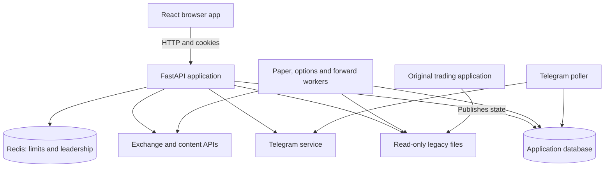
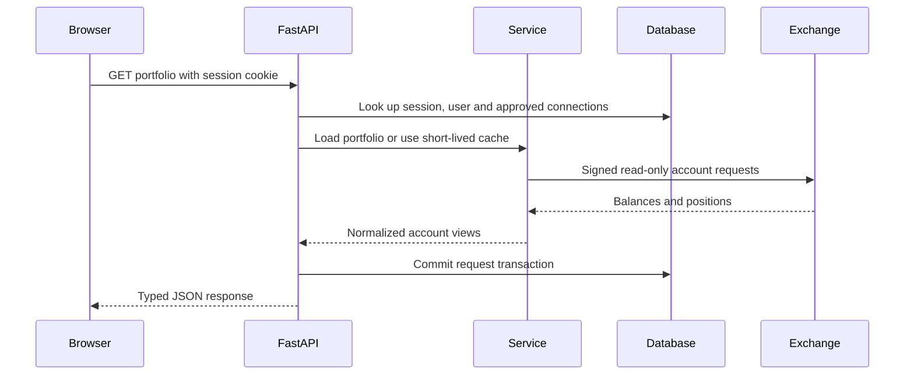
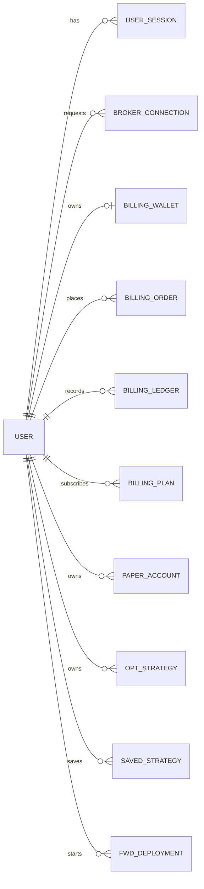
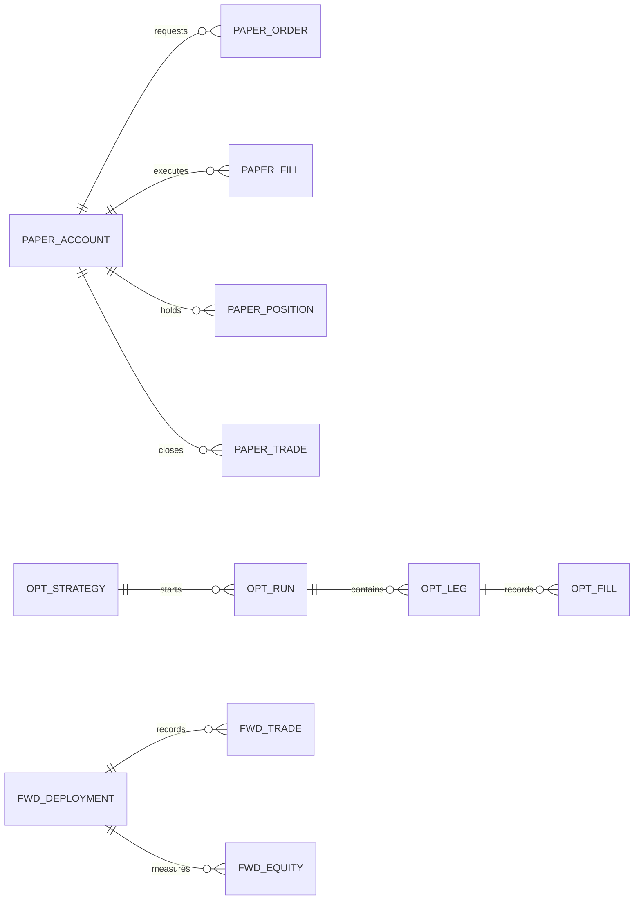
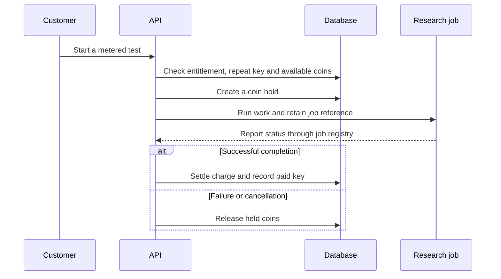
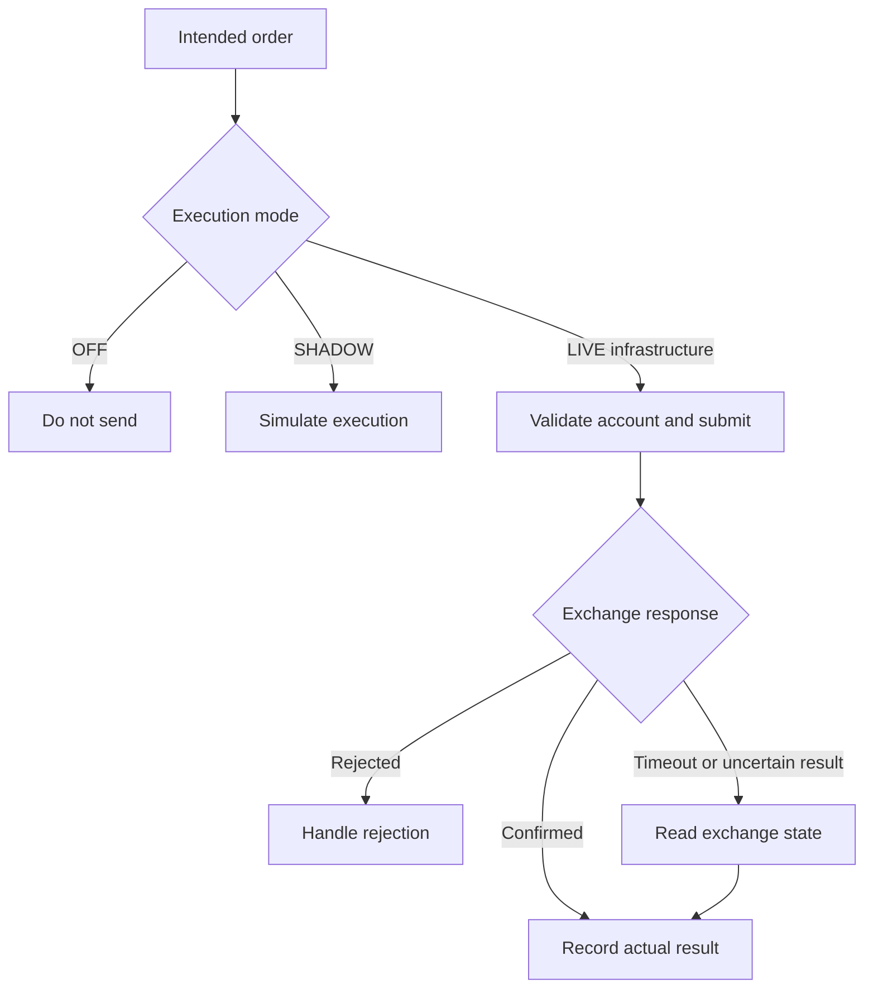

<a id="top"></a>

<div align="center">

# ⚙️ Technical Architecture

### Understand the code, the data and the operational boundaries.

**GTT Platform** · Freelance onboarding · Source review: **29 October 2026**

[Documentation home](../README.md) · [Business & crypto guide](BUSINESS_ANALYSIS.md)

</div>

---

> [!NOTE]
> **About the source:** these documents analyze the supplied developer review package, prepared on 25 September 2026. Source paths refer to that package; application source is not included in this documentation upload. Prices are code defaults, and runtime behavior has not been verified.

> [!IMPORTANT]
> This is a source review of a restricted developer package, not a production audit. Sixteen proprietary modules are deliberately stripped. Existing routes, screens and workers do not prove that the corresponding feature runs end to end. No code changes, deployment, database migration, payment or live order were performed.

## Contents

| Section | Explore |
| :---: | :--- |
| 01 | [Technical overview in simple language](#1-technical-overview-in-simple-language) |
| 02 | [Understand the three architectural boundaries](#2-understand-the-three-architectural-boundaries) |
| 03 | [Repository map: where to look first](#3-repository-map-where-to-look-first) |
| 04 | [Frontend: how a screen works](#4-frontend-how-a-screen-works) |
| 05 | [Backend request flow](#5-backend-request-flow) |
| 06 | [Database design](#6-database-design) |
| 07 | [Authentication, permissions and credential storage](#7-authentication-permissions-and-credential-storage) |
| 08 | [Market data, caching and external dependencies](#8-market-data-caching-and-external-dependencies) |
| 09 | [Billing: the most complete business subsystem](#9-billing-the-most-complete-business-subsystem) |
| 10 | [Background work: not all jobs are separate services](#10-background-work-not-all-jobs-are-separate-services) |
| 11 | [Execution mechanics: what remains and what is blocked](#11-execution-mechanics-what-remains-and-what-is-blocked) |
| 12 | [Missing modules and legacy data](#12-missing-modules-and-legacy-data) |
| 13 | [Deployment model and configuration](#13-deployment-model-and-configuration) |
| 14 | [Practical local setup](#14-practical-local-setup) |
| 15 | [Tests and confidence: what is proven versus claimed](#15-tests-and-confidence-what-is-proven-versus-claimed) |
| 16 | [Handover findings and proposed priorities](#16-handover-findings-and-proposed-priorities) |
| 17 | [Suggested reading order for a new developer](#17-suggested-reading-order-for-a-new-developer) |

---

## 1. Technical overview in simple language

GTT is organized as a **modular monolith**: one main Python backend contains several business modules. A React browser application calls that backend over HTTP. Some ongoing work has separate worker entry points, while billing housekeeping and research jobs still run inside API processes.

The key technologies are:

| Technology | Role in this project | Simple explanation |
| --- | --- | --- |
| Python 3.12+ | Backend language | Implements rules, HTTP endpoints and integrations |
| FastAPI | Web API | Maps an HTTP request to a Python function |
| Pydantic | Input/output validation and settings | Checks whether a request or configuration has the expected shape |
| SQLAlchemy | Database access | Maps Python objects and queries to database tables |
| Alembic | Schema migrations | Applies versioned changes to those tables |
| SQLite | Local development and tests | Database stored in a file or test memory |
| PostgreSQL | Intended production database | Shared database suitable for concurrent application processes |
| Redis | Shared request limits and housekeeping leadership | Coordinates selected state across processes |
| React 18 and TypeScript | Browser interface | Builds screens and catches many frontend type mistakes |
| Vite | Frontend development/build tool | Runs the development server and produces static assets |
| React Router | Browser navigation | Chooses which screen a URL displays |
| TanStack Query | Server-state fetching and caching | Manages loading, refreshing and error states for API data |
| Lightweight Charts | Chart rendering | Displays trading charts |
| HTTPX | Outbound HTTP | Calls exchange, feed and Telegram endpoints |
| pytest, Ruff, mypy, Vitest | Verification tools | Tests behavior, checks style and types |

The backend manifest requires Python **3.12 or newer**, despite the main README saying “3.9+” in one section. Installed dependency versions are pinned in the backend requirements. Frontend ranges and the lockfile govern JavaScript dependencies; use the lockfile when reproducing an environment.

**Evidence:** `pyproject.toml`; `requirements.txt`; `requirements-dev.txt`; `frontend/package.json`.

## 2. Understand the three architectural boundaries



**Boundary 1: browser and API.** The browser displays information; server-side code validates permissions, prices and requests.

**Boundary 2: application and exchange.** Portfolio adapters read external accounts. A separate execution package contains signed order mechanics. The application’s live controls remain blocked.

**Boundary 3: rebuild and legacy system.** Some research/results still depend on files produced by the original application. The replacement is incremental rather than a clean separation already completed.

The diagram includes worker scaffolding; paper/options workers cannot be considered operational in this copy because their central services are stripped.

**Evidence:** `src/gtt/main.py`; `workers/`; `services/legacy_store.py`; `services/execution/`.

## 3. Repository map: where to look first

| Path | Responsibility | Useful starting point |
| --- | --- | --- |
| `src/gtt/main.py` | App construction, router registration, startup and housekeeping | `create_app`, `_wire_billing`, `_billing_loop` |
| `src/gtt/core/` | Configuration, security, encryption, middleware and logging | `config.py`, `security.py`, `crypto.py` |
| `src/gtt/api/deps.py` | Authentication, admin checks, CSRF and request helpers | `current_user`, `require_admin`, `require_csrf` |
| `src/gtt/api/routers/` | HTTP endpoints grouped by feature | Start with auth, brokers, billing and market |
| `src/gtt/domain/` | Calculations and business rules | Billing and indicators remain; many trading modules are stubs |
| `src/gtt/services/` | Database operations and integration orchestration | Billing, brokers, market, legacy reads and jobs |
| `src/gtt/db/` | Models, session lifecycle and migrations | `base.py`, `models*.py` |
| `src/gtt/workers/` | Long-running process entry points | Paper, optauto, fwd and telegram_poller |
| `src/gtt/cli.py` | Admin creation and legacy imports | `main`, `create_admin` |
| `frontend/src/features/` | Screens, hooks, types and feature-local state | Mirrors backend product areas |
| `frontend/src/lib/api.ts` | Shared HTTP wrapper | Cookies, CSRF and typed errors |
| `frontend/src/App.tsx` | Routes and role-based screen availability | Main frontend inventory |
| `tests/` | Retained backend verification | Auth, brokers, billing rules, execution and hardening |
| `ops/`, `scripts/` | Deployment and operational helpers | Windows VPS scripts, Gunicorn and backups |
| `docs/` | Architectural decisions and historical plans | Useful context, but reconcile with source |

### Intended layering versus actual layering

The architecture document says API handlers should contain no SQL and business rules should be pure. The source follows this as a direction, not a fully enforced boundary: routers such as `brokers.py` query SQLAlchemy directly and combine validation, persistence and orchestration.

There is no need to invent a missing repository layer when explaining the project. The current implementation is mostly **router → service/domain → SQLAlchemy**, with some direct router-to-database access.

## 4. Frontend: how a screen works

`main.tsx` mounts React with a shared QueryClient. Default query data is considered fresh for 30 seconds, and refetch-on-window-focus is disabled. Individual hooks override polling settings where needed.

`App.tsx` first loads the current user. A true unauthenticated response leads to the login screen; a server failure gets a retry screen rather than being treated as logout. Authenticated routes include markets, strategies, paper, portfolio, options, Studio, billing, account and administration.

Admin-only navigation is useful for usability, but it is not the security boundary. The backend must also enforce the role and ownership.

The shared API wrapper:

1. Prefixes feature paths with `/api/v1`.
2. Sends cookies on same-origin requests.
3. Reads the CSRF cookie and adds `X-CSRF-Token` for unsafe methods.
4. Parses the structured API error into `ApiError`.
5. Emits a billing event when the server returns `insufficient_coins` or `plan_required`, allowing the interface to open the billing sheet.

Vite runs on port 5173 and proxies `/api` to port 8000. This keeps browser requests same-origin during development. There is no evidence here of a Next.js server or server-side rendering; this is a React single-page application.

Some complex feature state is stored in custom modules such as `builder/studioStore.ts` and `options/store.ts`. Styling combines shared components and legacy CSS. Expect behavior-preserving migration work, not a completely new design system.

**Evidence:** `frontend/src/main.tsx`; `App.tsx`; `lib/api.ts`; `vite.config.ts`.

## 5. Backend request flow



This represents the conceptual flow; the portfolio router itself currently contains much of this orchestration.

### Request lifecycle

`main.py` installs request context, rate limiting, gzip, security headers and optional CORS. It registers feature routers under `/api/v1`; health routes are outside that prefix.

`db/base.py::get_session` supplies one SQLAlchemy session per request. It commits after successful handling, rolls back on failure and always closes the session. Most database access is synchronous, even though some handlers perform asynchronous network calls.

Errors use a safe response shape such as:

```json
{"error": {"code": "not_authenticated", "message": "Please sign in."}}
```

Request identifiers and structured logging support tracing. Interactive API documentation is available in non-production environments and disabled when `GTT_ENV=prod`.

### Main API families

| Prefix or route | Purpose |
| --- | --- |
| `/api/v1/auth` | Login, logout, sessions, sign-up and reset |
| `/api/v1/profile` | Profile and account information |
| `/api/v1/market` | Prices, candles, option chain, calendar and coin-related views |
| `/api/v1/strategies` | Strategy catalogue and result views |
| `/api/v1/brokers`, `/api/v1/portfolio` | Exchange connection requests and account snapshots |
| `/api/v1/billing` | Public pricing, wallet, orders and payment references |
| `/api/v1/paper` | Simulated strategy accounts |
| `/api/v1/builder` | Templates, backtests, optimization and saved strategies |
| `/api/v1/builder/fwd` | Admin-controlled paper forward deployments |
| `/api/v1/optstudio` | Options research jobs and templates |
| `/api/v1/optauto` | Option-strategy management |
| `/api/v1/autotrade` | Customer allocations, accounts and controls |
| `/api/v1/admin/...` | Users, approvals, billing and auto-trade administration |
| `/api/v1/telegram` | Chat-linking controls |
| `/healthz`, `/readyz` | Process health and database readiness |

Consult each router for exact methods and schemas; this is a navigation map, not a generated endpoint contract.

## 6. Database design

The database stores application identity, customer state, billing history and simulation records. Legacy strategy records and historical option datasets are separate sources.

There are ten Alembic revision files in this package, covering the initial schema and feature additions. Some flexible strategy specifications and state are JSON stored inside database columns; using SQLAlchemy does not make all internal payloads relational or strongly validated.

### Main entity relationships



This is a simplified logical diagram, not a complete physical-schema export.

| Table group | What it stores |
| --- | --- |
| `users`, `user_sessions`, `login_events` | Identity, session digests and sign-in history |
| `audit_log` | Actor, action, target, detail, request ID and timestamp |
| `broker_connections` | Exchange identifier, encrypted credentials, status and decision metadata |
| `billing_wallets`, `billing_ledger` | Wallet lifecycle and the append-oriented credit history |
| `billing_orders`, `billing_plans`, `billing_coupons` | Purchases, subscription periods and discounts |
| `billing_holds`, `billing_meters`, `billing_paid_keys` | Reserved credits, daily usage and repeat-test tracking |
| `billing_config`, `billing_counters`, `billing_notices` | Versioned commercial settings, order sequence and customer notices |
| `paper_*` | Paper accounts, orders, fills, positions, closed trades, activity and equity |
| `opt_*` | Option strategies, runs, legs, fills, activity, curve and worker state |
| `fwd_*` | Forward deployments, trades, equity, activity and heartbeat |
| `builder_saved_strategies` | Saved rule specifications and result snapshots |
| `autotrade_allocations`, `autotrade_notices` | Per-user strategy allocation, account choice, mode and notices |
| `otp_challenges`, `telegram_*` | Verification challenges and Telegram linking |

### Trading records are intentionally separate



An order, fill, open position and closed trade are not interchangeable records. The distinction enables partial execution, P&L accounting and a history of what actually happened.

**Evidence:** `src/gtt/db/models*.py`; `src/gtt/db/migrations/versions/`.

## 7. Authentication, permissions and credential storage

### Sessions and passwords

Passwords use Argon2id. Session and CSRF tokens are random values; database rows hold their SHA-256 digests. The browser session cookie is HttpOnly, so JavaScript does not read it. The default session lifetime is 14 days.

Imported legacy PBKDF2 hashes are supported and upgraded to Argon2 after a successful login. Revocation is database-backed and can target devices. Disabled users are rejected when the current-session dependency runs.

The backend does not use JWTs as the main login mechanism. Session validity is checked against stored rows.

### CSRF and authorization

`require_csrf` compares the supplied header with the CSRF cookie and also checks its digest against the session record. `require_admin` checks the user’s role. Feature handlers also need ownership checks so customers cannot read another user’s object by changing its ID.

These protections are wired through dependencies on relevant routes. Their presence is not a mathematical guarantee that every future endpoint will be secure; new routes still need review and tests.

### Exchange API keys

`CredentialCipher` uses AES-256-GCM with random nonces. HKDF derives the encryption key from `GTT_SECRET_KEY`. Broker credentials are bound with associated data constructed as `broker:{user_id}:{broker}`. This is more precise than the architecture document’s generic “record ID” wording.

Keys are decrypted for server-side use and are not returned in portfolio responses. The UI receives a short key hint. Reject/revoke actions wipe the encrypted values; withdrawal deletes the row.

Changing the application secret without a controlled migration can make stored credentials unreadable. Encryption at rest also does not protect keys from an attacker who controls the running application and its secret.

### OTP delivery limitation

Challenge logic includes six-digit codes, a ten-minute expiry, attempt limits and resend controls. The application wiring has no real SMS provider. Its replacement sender logs the purpose and mobile number but **does not log or deliver the code**. The default service logger does log a code, but is normally replaced during application startup.

Therefore, the go-live note saying “codes are written to the log” is not a reliable instruction for recovering a code from the normal app. Supply a proper delivery adapter or a deliberately controlled test fixture.

### Controls still requiring validation

Two-factor authentication is not implemented in the reviewed application. Audit records are inserted by the application, but “append-only” should not be read as proof of database-level immutability. Broker onboarding text asks users to avoid withdrawals; the reviewed connection probe does not establish complete enforcement of every exchange permission.

**Evidence:** `core/security.py`; `core/crypto.py`; `api/deps.py`; `api/routers/auth.py`; `api/routers/brokers.py`; `services/onboarding.py`; `main.py::_wire_billing`.

## 8. Market data, caching and external dependencies

| Dependency | Purpose | Important boundary |
| --- | --- | --- |
| Delta public API | Products, prices, candles and options | Market-data client has no customer credentials or order methods |
| Broker adapters | Approved account snapshots from four exchanges | Read-only integration coverage is broader than verified trading support |
| CoinGecko | Additional market information | External requests can fail or be rate-limited |
| RSS feeds | Crypto headlines | Feed availability and parsing are external dependencies |
| Fair Economy calendar feed | Economic events | Not a local authoritative schedule |
| Telegram Bot API | Link codes and notifications | Requires a token and a poller |
| Legacy state directory | Strategy records and tracker state | Outside the supplied source package |
| Option history directory | Research datasets | Also outside the supplied source package |

`TTLCache` is an asynchronous **in-memory** cache with “single-flight”: when a value expires, one caller fetches it and concurrent callers wait for that result. It reduces duplicated upstream calls inside one process.

It is **not Redis-backed**. Each API worker and standalone worker has its own cache. Some configuration comments imply a shared market cache, but the implementation constructs a local `TTLCache()`. Identical cache keys in different processes do not share values.

Portfolio snapshots have a short TTL. Market prices are frequently polled by the frontend. WebSockets or SSE could reduce repeated payloads, but would not remove the need to send data to each subscribed browser. The go-live document’s suggestion that WebSockets remove the per-tab multiplier entirely is too strong.

**Evidence:** `services/cache.py`; `main.py`; `services/market/`; `api/routers/brokers.py::PORTFOLIO_TTL`; `services/paper_market.py`.

## 9. Billing: the most complete business subsystem

The domain module defines plan prices, credit validity, quote calculations, tax-line splits, coupons and daily metering rules. The service persists those decisions using the caller’s database session.

Coins are modeled as expiring lots reconstructed from ledger events. Available balance is not simply “sum of every historical credit.” Expiry and active holds must be considered.



This describes intended orchestration; actual timing differs between synchronous and background-job endpoints, and the missing engines prevent full validation here.

Orders are server-priced. Customers submit UPI references and admins approve or reject them. Config changes are versioned. Daily metering warns about insufficient credits and later requests a pause through hooks.

`_wire_billing` connects billing to Telegram, research-job status, running paper/option items and auto-trade entitlements. Several comments in individual services still say a hook is not wired, although `main.py` does wire it. Conversely, a wired hook can point to a stripped function; wiring alone does not establish availability.

Concurrency and idempotency should be verified against PostgreSQL before scaling billing. A Redis leader reduces normal duplicate housekeeping work, but does not replace transaction-level correctness.

**Evidence:** `domain/billing.py`; `services/billing.py`; `models_billing.py`; `main.py::_wire_billing`.

## 10. Background work: not all jobs are separate services

| Process or job | Intended work | Current caveat |
| --- | --- | --- |
| API process | HTTP and optional billing/margin housekeeping | Also owns in-memory caches and research job registries |
| `gtt.workers.paper` | Step running paper accounts, approximately every two seconds | Core paper service/domain are removed |
| `gtt.workers.optauto` | Schedule and update option runs, approximately every two seconds | Domain/service removed; candle evaluator is also an unwired seam |
| `gtt.workers.fwd` | Evaluate new closed candles for paper deployments | Depends on stripped strategy engine; documented single-instance requirement |
| `gtt.workers.telegram_poller` | Handle chat-linking updates | Run one poller per bot token |
| Builder jobs | Parameter grid and enhancer work | Threads with an in-process registry |
| Options Studio jobs | Research work in a thread pool | In-process job/result registry; external historical data needed |

The API housekeeping loop wakes every two seconds, does heavier billing work roughly once a minute, and rechecks auto-trade margins approximately every five minutes while leading. Redis leadership controls which API process performs it.

The options, paper and forward workers should not be multiplied blindly: their documented assumptions include one instance per database. The housekeeping lease is not a universal lock for all these workers.

**Process-memory limitation:** a job started by API worker A may be unknown when the browser polls worker B. Restarting A loses its in-memory job state. This can also affect which process can settle a billing hold. A durable job queue/result store or a deliberately constrained single-process setup is needed before claiming horizontally scalable research jobs.

**Evidence:** `workers/*.py`; `services/builder_jobs.py::JobRegistry`; `services/optstudio_jobs.py::JobRunner`; `services/leader.py`.

## 11. Execution mechanics: what remains and what is blocked

The execution package is valuable infrastructure, but is not a complete trading platform.

| Component | Responsibility |
| --- | --- |
| `execution/base.py` | Shared types and executor interface: products, quotes, orders, positions and failure categories |
| `execution/delta.py` | Signed Delta execution requests and account checks |
| `execution/shadow.py` | Simulated execution without live exchange writes |
| `execution/perps.py` | Opening, protective stops, closing, kill and reconciliation orchestration |
| `execution/options.py` | Multi-leg execution and cleanup orchestration |
| `execution/accounts.py` | Account choice, identity pinning and conflicting strategy claims |
| `execution/sizing.py` | Proprietary sizing policy; removed |

### Why an unknown outcome is not a failed order



An HTTP timeout can happen after an exchange accepted an order. Blindly sending it again could double a position. The code distinguishes `ExchangeError` from `ExchangeUnknown` so callers can reconcile uncertain outcomes first.

Account pinning checks that credentials still belong to the intended exchange account. Claim scopes help prevent two strategies from interfering with the same netted position. Current registries and choice storage include in-memory structures, so cross-process enforcement is not established.

Live activation in the application is rejected with `live_not_available` on implemented control paths such as auto-trade and forward testing. Some options paths instead encounter stripped services. **Low-level live-order code exists**, so the correct statement is “live product workflows are blocked,” not “this source contains no order-sending code.”

**Evidence:** execution package; `services/autotrade.py`; `api/routers/fwd.py`; `README_FOR_DEVELOPER.txt`.

## 12. Missing modules and legacy data

### The 16 explicitly stripped modules

| Group | Files under `src/gtt/` |
| --- | --- |
| Strategy rule engine and optimization | `domain/strategy_engine.py`, `domain/strategy_opt.py` |
| Templates and library data | `domain/strategy_templates.py`, `domain/strategy_library.py`, `domain/strategy_library_data.py` |
| Result assembly | `domain/strategy_results.py` |
| DCA and options research | `domain/dca.py`, `domain/optstudio.py` |
| Options automation | `domain/optauto.py`, `services/optauto.py` |
| Paper simulation | `domain/paper.py`, `services/paper.py` |
| Risk and sizing | `domain/margin.py`, `services/execution/sizing.py` |
| Signals and verdict | `domain/signals.py`, `domain/verdict.py` |

Names and signatures remain, but bodies raise `NotImplementedError` and constants can be empty or zero. These placeholder values must not be interpreted as genuine risk parameters.

`services/legacy_store.py` reads `GTT_LEGACY_DIR`, defaulting to `~/crypto`. It loads files such as trade state, breakout state, covered-call state, option logs, library trackers and presets. It caches by modification time and size. Missing/unreadable files return empty structures with logging.

Legacy Python data modules are parsed using AST and literal values rather than imported and executed. That is a useful data boundary.

Options research separately reads `GTT_OPTDATA_DIR`, defaulting to `~/crypto/cache/optbt`, through `services/optdata.py`.

The migration plan references a general `scripts/import_legacy_state.py`, but that script is not present in this package. Actual available import routes are the CLI’s user/broker imports and `scripts/import_legacy_billing.py`. Do not assume a complete migration tool exists.

**Evidence:** handover note; removed-module headers; `services/legacy_store.py`; `services/optdata.py`; `cli.py`; script inventory.

## 13. Deployment model and configuration

### Development versus production

| Concern | Local default / available implementation | Production implication |
| --- | --- | --- |
| Database | SQLite with WAL, foreign keys and busy timeout | Guardrails reject SQLite in prod |
| Rate limits | In-memory without Redis | Redis required by prod guardrails |
| Session transport | Non-secure cookie allowed locally | Secure cookie required in prod |
| Secret | Development placeholder | Non-default secret of sufficient length required |
| API docs | Available outside prod | Disabled in prod |
| Web serving | Vite during development | Built frontend expected to be served by app or proxy |
| Process management | Uvicorn; Windows scheduled-task scripts also present | Gunicorn configuration supplied for compatible hosts |
| Backups | Script includes dump/restore verification intent | Must execute and verify in the chosen infrastructure |

The production guardrails reject obvious unsafe configuration. They do not prove that PostgreSQL/Redis are reachable, SMS is wired, historical data exists or trading services are healthy. `/readyz` checks the database, not the entire dependency graph.

Default database pool settings are 20 regular connections plus 20 overflow per API process. Gunicorn defaults to `min(2 × CPU cores + 1, 9)` workers unless overridden. Nine workers could therefore permit 360 API connections before adding background workers and operational connections. Size this deliberately.

Windows VPS scripts describe a Tailscale-accessed instance, with the original and rebuilt applications on separate ports. This is evidence of deployment tooling and intended layout, not verified current hosting.

### Frontend build serving

Vite outputs to the repository’s `frontend/dist`. The backend derives the same location from `main.py`; the path calculation was checked during this review. If the build is absent, the backend skips mounting the SPA. Deep links return the app shell when mounted, while unknown API routes stay API errors. The retained SPA tests use temporary build directories.

### Backup caveat

The backup script intends to restore each PostgreSQL dump into a scratch database and check the users table before keeping it. Its generated database name includes a hyphen, while fallback SQL interpolates the name without identifier quoting; inspect the createdb invocation and cleanup as well. Treat the PostgreSQL restore drill as unverified until exercised safely in staging.

**Evidence:** `core/config.py`; `db/base.py`; `ops/gunicorn.conf.py`; `ops/*.ps1`; `main.py::FRONTEND_DIST`; `tests/test_spa.py`; `scripts/backup.sh`.

## 14. Practical local setup

These are corrected onboarding instructions to try in an isolated development environment, not commands executed during this review.

### Prerequisites

Use Python 3.12+; the handover recommends Node 22+. Confirm that `python3` points to the intended interpreter before using `make install`. In this review shell, `python3` was Python 3.9.6 and no project `.venv` or frontend dependency directory was present.

### Backend

Run these commands from the **original application source package**. A clone containing only these documents will not contain the application, requirements or Makefile.

```bash
python3.12 -m venv .venv
source .venv/bin/activate
python -m pip install -r requirements.txt -r requirements-dev.txt
python -m pip install -e .
cp .env.example .env
alembic upgrade head
python -m gtt.cli create-admin --mobile 91XXXXXXXXXX --name "Owner"
make run
```

Replace the example mobile with the agreed local test account. Configure a development secret and a disposable database. The explicit editable install makes the `src` package importable; the supplied Makefile does not include that installation step.

Do not expect empty strategy constants or absent historical data to become usable after dependency installation. Request sanctioned fixtures or a private engine integration from the client.

### Frontend, in another terminal

```bash
cd frontend
npm ci
npm run dev
```

Open the Vite URL on port 5173. API development docs should be on port 8000 at `/docs`.

The README-for-developer mentions `make setup`, but the actual target is `make install`. The environment-aware sequence above avoids assuming the system Python is supported.

### Verification commands to run when the environment is ready

```bash
make check
cd frontend
npm run typecheck
npm run lint
npm test
npm run build
```

These are baseline checks to establish, not a claim that they currently pass. Stripped modules may fail lint/type checks or block feature execution. Fixing or excluding them should be an agreed review-copy policy, not silently replacing proprietary rules.

## 15. Tests and confidence: what is proven versus claimed

The handover note reports **217 passing tests** when the copy was prepared. That result was not rerun here.

The retained test files cover authentication, sessions, profile, broker adapters and approvals, billing-domain rules, cryptography, market helpers, execution client/shadow behavior, onboarding, Telegram, caching, health and production configuration.

The GitHub Actions workflow runs Ruff, mypy and pytest on Python 3.12 and 3.14. The reviewed workflow has no frontend job. Frontend package scripts and a builder specification test file exist, but their execution is not established by that backend workflow.

Tests in `conftest.py` use a disposable in-memory SQLite database and FastAPI TestClient. That is useful for API behavior, but does not by itself validate PostgreSQL locking, multi-worker job visibility, production network failures, or actual exchange orders.

The package explicitly omits tests that would expose proprietary logic. No parity or shadow evidence for live-engine migration was available. A green retained suite would still not prove the omitted strategies work.

### Review limitations

- The original local review directory did not contain usable Git metadata, so no source commit hash, branch or remote was available. The GitHub commit containing this document versions the documentation, not the reviewed application source.
- The exposed default interpreter was below the supported Python version.
- Dependencies and services were not installed or started for this documentation task.
- No tests, builds, deployment, live UI session or exchange call with customer credentials were executed.
- Static findings are labeled as such; historical performance/load claims in existing docs were not reproduced.

## 16. Handover findings and proposed priorities

These are proposed next steps, not modifications already made.

| Priority | Finding | Evidence | Practical next step |
| --- | --- | --- | --- |
| P0 for scope | Core functionality is deliberately missing | Handover note and 16 stripped modules | Agree permitted implementation scope and obtain fixtures/interface contracts |
| P0 for live work | Live product paths are blocked while low-level send code remains | Auto-trade/fwd guards; execution client | Keep live migration a separately accepted workstream |
| P1 for onboarding | SMS sender is not functional; normal wiring does not reveal the code | `main.py::_wire_billing` | Add a tested delivery adapter and sandbox account flow |
| P1 for demo | No complete built-and-running review environment was supplied | Missing dependencies, stripped engines and external datasets | Build the frontend and verify the agreed available customer journeys |
| P1 for UI | AI builder requests an absent backend route | `studioStore.ts::aiBuild`; builder router | Hide or clearly gate the action until an endpoint is supplied |
| P1 for scaling | Research jobs and market caches are process-local | JobRegistry, JobRunner and TTLCache | Design shared jobs/results and intentional cache boundaries |
| P1 for operations | Worker single-instance assumptions are not general distributed locks | Worker docs and leader service | Define process counts, supervision and restart rules |
| P1 for recovery | Backup restore/cleanup paths need an executed drill | `scripts/backup.sh` | Test with a disposable PostgreSQL database |
| P2 for quality | Documentation overstates clean layering and shared caching | SQL in routers; local TTLCache | Update architecture notes and decide future boundaries |
| P2 for reproducibility | Version/setup notes conflict; no frontend CI job | Manifests, Makefile, workflow | Provide a supported setup and complete CI baseline |
| P2 for launch | Manual payments, no app MFA, missing full journey evidence | Billing flow and go-live notes | Agree product and operational launch requirements |

### Suggested delivery stages

**Stage A — establish the baseline.** Obtain a versioned private source reference, define what this restricted package is allowed to do, select supported runtimes, document fixture data and reproduce the retained checks.

**Stage B — validate customer journeys.** Test login, ownership checks, approved portfolio reads, manual payment approval and credit accounting. Explicitly gate unavailable screens and fix observed integration gaps.

**Stage C — make operation reliable.** Rehearse database migration/restore, verify multi-process behavior, add monitoring for workers and data freshness, and resolve job durability.

**Stage D — migrate trading only if contracted.** Follow the existing migration intent: characterize old behavior, shadow it on recorded/live data, compare decisions, then switch one engine at a time with explicit operational control and rollback. The strategy owner must supply the private logic and acceptable differences.

Each stage needs concrete acceptance evidence. A screen loading is insufficient evidence for trading correctness or money-accounting correctness.

## 17. Suggested reading order for a new developer

1. `README_FOR_DEVELOPER.txt` — understand what was deliberately removed.
2. `frontend/src/App.tsx` — map the product screens.
3. `src/gtt/main.py` — see startup, wiring and process responsibilities.
4. `src/gtt/api/deps.py` and `core/security.py` — understand access control.
5. `db/models.py` and `db/models_billing.py` — understand identity and commercial state.
6. `api/routers/brokers.py` — trace one integration end to end.
7. `domain/billing.py` and `services/billing.py` — follow complete business rules and persistence.
8. `services/legacy_store.py` — understand dependencies outside this package.
9. `services/execution/base.py`, `delta.py`, `perps.py` and `accounts.py` — study retained execution mechanics.
10. `tests/`, `ops/` and `docs/MIGRATION_PLAN.md` — compare verification and operational intent with reality.

For the product purpose, beginner crypto vocabulary and customer economics, start with the companion business guide. For exchange integration details, consult the [official Delta API documentation](https://docs.delta.exchange/) alongside the checked-in adapters; external API documentation does not prove this adapter was tested against the current service.


---

<div align="center">

**Continue exploring**

[← Documentation home](../README.md) · [Business & crypto guide →](BUSINESS_ANALYSIS.md) · [Back to top](#top)

</div>
